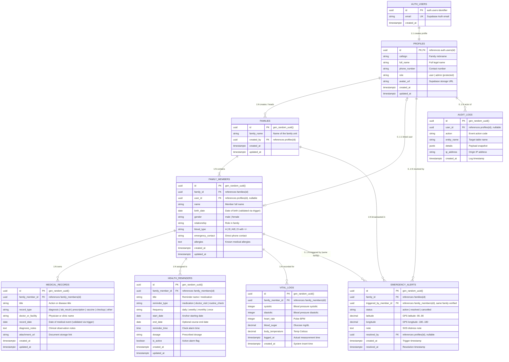

# Spesifikasi Basis Data & Entity Relationship Diagram (ERD) Final — CareFam

> **Dokumen:** Database Architecture, Final ERD Specification & Data Dictionary (Versi 2.1 - Production Hardened)  
> **Status Dokumen:** FINAL & PRODUCTION HARDENED SPECIFICATION  
> **Sistem:** CareFam — Family Healthcare Management System  
> **Database Engine:** PostgreSQL 15+ (Supabase Native)  
> **Tingkat Normalisasi:** Third Normal Form (3NF)  
> **Standar Keamanan:** Row Level Security (RLS), Role-Based Access Control (RBAC), Least Privilege & Medical Privacy Compliance  

---

## 1. Pendahuluan & Logika Bisnis CareFam

CareFam adalah aplikasi *Integrated Family Health Companion* yang dirancang untuk mengonsolidasikan pemantauan kesehatan keluarga ke dalam satu pintu terpadu. Sistem mengelola data medis personal yang sensitif sehingga arsitektur basis data dirancang dengan standar keamanan tinggi, integritas data ketat, dan kepatuhan privasi medis.

### 1.1. Prinsip Keamanan & Otorisasi Ketat
1. **Pemisahan Kredensial & Profil (Separation of Concerns):**
   - Kredensial, email, kata sandi, dan sesi token ditangani secara eksklusif oleh Supabase Auth (`auth.users`).
   - Setiap pengguna memiliki tepat satu baris pada `public.profiles` (Relasi 1:1) yang menyimpan atribut personal, *callsign* (nama panggilan keluarga), dan peran otorisasi (`user` atau `admin`).
2. **Pencegahan Eskalasi Peran & Bootstrap Admin yang Aman (Zero Privilege Escalation):**
   - Pengguna yang mendaftar secara mandiri (`auth.signUp`) **selalu dan hanya** mendapatkan peran `'user'`. Trigger registrasi `handle_new_user()` dilarang mengambil nilai role dari `raw_user_meta_data`.
   - Policy `profiles_insert_own` mengunci secara deklaratif bahwa `role` yang dimasukkan oleh pengguna wajib bernilai `'user'`.
   - Kolom `role` pada `public.profiles` dilindungi oleh database trigger `protect_profiles_role()`: pengguna biasa dilarang mengubah kolom `role` miliknya sendiri. Penetapan peran `'admin'` hanya diizinkan untuk sesi administratif terpercaya (eksekusi langsung konsol database / SQL Editor Supabase via `current_user IN ('postgres', 'service_role')` atau oleh admin terotentikasi yang sah).
3. **Hirarki Hak Akses Keluarga (Family Head vs. Linked Member):**
   - **Kepala Keluarga (Family Head / Creator):** Pengguna yang membentuk keluarga (`families.created_by = auth.uid()`). Memiliki hak penuh menambah, menyunting, dan menghapus anggota di dalam keluarganya.
   - **Anggota Tertaut (Linked Member):** Pengguna aplikasi yang profilnya ditautkan ke suatu baris anggota keluarga (`family_members.user_id = auth.uid()`). **Hanya diizinkan menyunting data dirinya sendiri**, dilarang mengubah anggota keluarga lain, dan dilarang mengubah `family_id` maupun `user_id`.
4. **Kepatuhan Privasi Medis Penuh (Medical Privacy & Least Privilege):**
   - Data rekam medis (`medical_records`), jadwal pengingat (`health_reminders`), dan pemantauan tanda vital (`vital_logs`) **hanya dapat diakses oleh anggota keluarga bersangkutan**.
   - Administrator sistem **dilarang membaca, menyunting, maupun menghapus rekam medis privat dan tanda vital pasien**. Hak `DELETE` pada `medical_records` murni menjadi hak Kepala Keluarga. Tanggung jawab administrator terbatas pada *User Management*, audit sistem, dan pemantauan teknis darurat (*SOS Monitoring*).
5. **Integritas Relasional Sinyal Darurat SOS (`emergency_alerts`):**
   - Anggota yang memicu darurat (`triggered_by_member_id`) wajib terverifikasi secara relasional berasal dari `family_id` yang sama melalui foreign key dan trigger `validate_emergency_alert_lifecycle()`.
   - Penghapusan data anggota keluarga tidak memicu error *null-constraint* pada `family_id`.
   - Perubahan status insiden (`active` -> `resolved` / `cancelled`) divalidasi ketat: `resolved_at` ditetapkan oleh database menggunakan `NOW()`, dan `resolved_by` otomatis disematkan identitas pemanggil `auth.uid()`, melarang masukan palsu dari klien.
6. **Integritas Klinis Data Vital (`vital_logs`):**
   - Tekanan darah sistolik dan diastolik wajib disimpan berpasangan (keduanya terisi atau keduanya null).
   - Tekanan sistolik wajib lebih besar daripada diastolik dengan selisih tekanan nadi (*pulse pressure*) minimal 10 mmHg.
   - Menolak pencatatan baris kosong tanpa metrik vital sama sekali.
7. **Kepatuhan Immutabilitas PostgreSQL (No CURRENT_DATE in CHECK):**
   - Validasi tanggal masa depan pada tanggal lahir (`birth_date`) dan tanggal rekam medis (`record_date`) dipindahkan dari `CHECK` constraint ke trigger database untuk memenuhi standar *immutability* PostgreSQL.

---

## 2. Diagram Entity Relationship (ERD) Final

---

## 3. Kamus Data (Data Dictionary) Lengkap

### 3.1. Entitas `profiles`
Menyimpan atribut pengguna aplikasi di luar sistem credential auth Supabase.

| Kolom | Tipe Data | Constraint | Keterangan & Aturan Bisnis |
|---|---|---|---|
| `id` | `UUID` | **PK**, **FK** `auth.users(id)` **ON DELETE CASCADE** | Identitas tunggal pengguna terhubung 1:1 ke tabel autentikasi Supabase. |
| `callsign` | `VARCHAR(50)` | Nullable | Nama panggilan keluarga (misal: "Ayah Naufal", "Ibu Siti"). Default 'Keluarga'. |
| `full_name` | `VARCHAR(100)` | Nullable | Nama resmi lengkap pengguna. |
| `phone_number` | `VARCHAR(20)` | Nullable | Nomor telepon aktif pengguna untuk komunikasi darurat. |
| `role` | `VARCHAR(20)` | **NOT NULL**, Default: `'user'`, `CHECK (role IN ('user', 'admin'))` | Peran otorisasi sistem. **Terproteksi trigger & RLS**: Pengguna biasa dilarang menetapkan role admin. |
| `avatar_url` | `TEXT` | Nullable | URL berkas foto profil yang disimpan di Supabase Storage. |
| `created_at` | `TIMESTAMPTZ` | **NOT NULL**, Default: `NOW()` | Timestamp pembuatan akun pengguna. |
| `updated_at` | `TIMESTAMPTZ` | **NOT NULL**, Default: `NOW()` | Timestamp pembaruan data akun (diperbarui otomatis via trigger). |

---

### 3.2. Entitas `families`
Mewakili wadah atau unit keluarga tempat berkumpulnya anggota keluarga.

| Kolom | Tipe Data | Constraint | Keterangan & Aturan Bisnis |
|---|---|---|---|
| `id` | `UUID` | **PK**, Default: `gen_random_uuid()` | Pengenal unik grup keluarga. |
| `family_name` | `VARCHAR(100)` | **NOT NULL**, `CHECK (length(trim(family_name)) > 0)` | Nama grup keluarga (misal: "Keluarga Santoso"). |
| `created_by` | `UUID` | **FK** `profiles(id)` **ON DELETE CASCADE**, **NOT NULL** | Pengguna pemilik/kepala keluarga yang membentuk grup keluarga ini. |
| `created_at` | `TIMESTAMPTZ` | **NOT NULL**, Default: `NOW()` | Waktu pembentukan grup keluarga. |
| `updated_at` | `TIMESTAMPTZ` | **NOT NULL**, Default: `NOW()` | Waktu pembaruan data keluarga (diperbarui otomatis via trigger). |

---

### 3.3. Entitas `family_members`
Profil personal dan data kesehatan individual tiap anggota keluarga dalam satu grup keluarga.

| Kolom | Tipe Data | Constraint | Keterangan & Aturan Bisnis |
|---|---|---|---|
| `id` | `UUID` | **PK**, Default: `gen_random_uuid()` | Pengenal unik anggota keluarga. |
| `family_id` | `UUID` | **FK** `families(id)` **ON DELETE CASCADE**, **NOT NULL** | Grup keluarga tempat anggota ini terdaftar. |
| `user_id` | `UUID` | **FK** `profiles(id)` **ON DELETE SET NULL**, Nullable | Tautan akun login jika anggota ini memasang aplikasi. Dibatasi unik per keluarga. |
| `name` | `VARCHAR(100)` | **NOT NULL**, `CHECK (length(trim(name)) > 0)` | Nama lengkap anggota keluarga. |
| `birth_date` | `DATE` | **NOT NULL** | Tanggal lahir (divalidasi `<= CURRENT_DATE` via trigger database). |
| `gender` | `VARCHAR(10)` | Nullable, `CHECK (gender IN ('male', 'female'))` | Jenis kelamin anggota keluarga. |
| `relationship` | `VARCHAR(50)` | **NOT NULL**, `CHECK (length(trim(relationship)) > 0)` | Status hubungan keluarga (Kepala Keluarga, Istri, Suami, Anak, Kakek, Nenek, dll). |
| `blood_type` | `VARCHAR(5)` | Nullable, `CHECK (blood_type IN ('A', 'B', 'AB', 'O', 'A+', 'A-', 'B+', 'B-', 'AB+', 'AB-', 'O+', 'O-', '-'))` | Golongan darah lengkap dengan rhesus untuk tindakan transfusi darurat. |
| `emergency_contact`| `VARCHAR(25)` | Nullable | Nomor darurat yang dapat segera dihubungi jika terjadi insiden. |
| `allergies` | `TEXT` | Nullable | Riwayat alergi obat atau makanan (informasi kritis bagi penanganan medis). |
| `created_at` | `TIMESTAMPTZ` | **NOT NULL**, Default: `NOW()` | Waktu pencatatan anggota keluarga. |
| `updated_at` | `TIMESTAMPTZ` | **NOT NULL**, Default: `NOW()` | Waktu pembaruan data anggota (diperbarui otomatis via trigger). |

---

### 3.4. Entitas `medical_records`
Menyimpan arsip riwayat pemeriksaan fisik, hasil lab, resep obat, vaksin, dan resume medis.

| Kolom | Tipe Data | Constraint | Keterangan & Aturan Bisnis |
|---|---|---|---|
| `id` | `UUID` | **PK**, Default: `gen_random_uuid()` | Pengenal unik berkas rekam medis. |
| `family_member_id` | `UUID` | **FK** `family_members(id)` **ON DELETE CASCADE**, **NOT NULL** | Anggota keluarga pemilik rekam medis ini. |
| `title` | `VARCHAR(150)` | **NOT NULL**, `CHECK (length(trim(title)) > 0)` | Judul pemeriksaan (misal: "Pemeriksaan Gula Darah & Kolesterol"). |
| `record_type` | `VARCHAR(50)` | **NOT NULL**, `CHECK (record_type IN ('diagnosis', 'lab_result', 'prescription', 'vaccine', 'checkup', 'other'))` | Kategori rekam medis. |
| `doctor_or_facility`| `VARCHAR(150)`| Nullable | Nama dokter, klinik, atau rumah sakit pemeriksa. |
| `record_date` | `DATE` | **NOT NULL** | Tanggal pemeriksaan medis (divalidasi `<= CURRENT_DATE` via trigger). |
| `diagnosis_notes` | `TEXT` | Nullable | Catatan observasi dokter, anjuran pengobatan, dan hasil pemeriksaan. |
| `attachment_url` | `TEXT` | Nullable | Tautan berkas bukti digital (PDF hasil lab / foto resep) di Supabase Storage. |
| `created_at` | `TIMESTAMPTZ` | **NOT NULL**, Default: `NOW()` | Waktu input berkas ke dalam sistem. |
| `updated_at` | `TIMESTAMPTZ` | **NOT NULL**, Default: `NOW()` | Waktu pembaruan catatan rekam medis (diperbarui otomatis via trigger). |

---

### 3.5. Entitas `health_reminders`
Mengatur alarm dan notifikasi pengingat konsumsi obat serta jadwal kontrol medis berkala.

| Kolom | Tipe Data | Constraint | Keterangan & Aturan Bisnis |
|---|---|---|---|
| `id` | `UUID` | **PK**, Default: `gen_random_uuid()` | Pengenal unik jadwal pengingat. |
| `family_member_id` | `UUID` | **FK** `family_members(id)` **ON DELETE CASCADE**, **NOT NULL** | Anggota keluarga yang wajib mematuhi pengingat ini. |
| `title` | `VARCHAR(100)` | **NOT NULL**, `CHECK (length(trim(title)) > 0)` | Nama obat atau agenda kontrol (misal: "Amlodipine 5mg"). |
| `reminder_type` | `VARCHAR(50)` | **NOT NULL**, `CHECK (reminder_type IN ('medication', 'doctor_visit', 'routine_check'))` | Tipe agenda pengingat. |
| `frequency` | `VARCHAR(50)` | **NOT NULL**, Default: `'daily'`, `CHECK (frequency IN ('daily', 'weekly', 'monthly', 'once'))` | Frekuensi pengulangan alarm. |
| `start_date` | `DATE` | **NOT NULL**, Default: `CURRENT_DATE` | Tanggal awal berlakunya pengingat. |
| `end_date` | `DATE` | Nullable, `CHECK (end_date IS NULL OR end_date >= start_date)` | Batas akhir pengingat (misal: obat antibiotik selama 7 hari). |
| `reminder_time` | `TIME` | **NOT NULL** | Waktu spesifik alarm pengingat berbunyi setiap harinya. |
| `dosage` | `VARCHAR(50)` | Nullable | Dosis pemakaian (misal: "1 tablet sesudah makan pagi"). |
| `is_active` | `BOOLEAN` | **NOT NULL**, Default: `TRUE` | Status aktif/nonaktif sakelar alarm pengingat. |
| `created_at` | `TIMESTAMPTZ` | **NOT NULL**, Default: `NOW()` | Waktu pembuatan pengingat. |
| `updated_at` | `TIMESTAMPTZ` | **NOT NULL**, Default: `NOW()` | Waktu perubahan jadwal (diperbarui otomatis via trigger). |

---

### 3.6. Entitas `vital_logs`
Menyimpan hasil pengukuran tanda-tanda vital tubuh anggota keluarga secara periodik.

| Kolom | Tipe Data | Constraint | Keterangan & Aturan Bisnis |
|---|---|---|---|
| `id` | `UUID` | **PK**, Default: `gen_random_uuid()` | Pengenal unik entri pengukuran vital. |
| `family_member_id` | `UUID` | **FK** `family_members(id)` **ON DELETE CASCADE**, **NOT NULL** | Anggota keluarga yang diukur tanda vitalnya. |
| `systolic` | `INT` | Nullable, `CHECK (systolic BETWEEN 50 AND 300)` | Tekanan darah sistolik (mmHg). |
| `diastolic` | `INT` | Nullable, `CHECK (diastolic BETWEEN 30 AND 200)` | Tekanan darah diastolik (mmHg). |
| `heart_rate` | `INT` | Nullable, `CHECK (heart_rate BETWEEN 30 AND 250)` | Frekuensi denyut nadi per menit (BPM). |
| `blood_sugar` | `DECIMAL(5,2)` | Nullable, `CHECK (blood_sugar BETWEEN 20.00 AND 999.99)` | Kadar glukosa darah sewaktu (mg/dL). |
| `body_temperature`| `DECIMAL(4,1)` | Nullable, `CHECK (body_temperature BETWEEN 32.0 AND 44.0)` | Suhu tubuh aktual (°C). |
| `logged_at` | `TIMESTAMPTZ` | **NOT NULL**, Default: `NOW()` | Waktu aktual dilakukannya pengukuran oleh pengguna. |
| `created_at` | `TIMESTAMPTZ` | **NOT NULL**, Default: `NOW()` | Waktu penyimpanan baris data ke dalam database. |

> **Constraint Integritas Pasangan Tanda Vital:**
> 1. `CHECK ((systolic IS NULL AND diastolic IS NULL) OR (systolic IS NOT NULL AND diastolic IS NOT NULL AND systolic > diastolic AND (systolic - diastolic) >= 10))` — Tekanan darah wajib disimpan berpasangan; tidak boleh tersimpan parsial; sistolik wajib lebih besar dari diastolik dengan selisih minimal 10 mmHg.
> 2. `CHECK (systolic IS NOT NULL OR diastolic IS NOT NULL OR heart_rate IS NOT NULL OR blood_sugar IS NOT NULL OR body_temperature IS NOT NULL)` — Menolak pencatatan baris kosong tanpa nilai vital sama sekali.

---

### 3.7. Entitas `emergency_alerts`
Merekam sinyal darurat (Emergency SOS) yang dipicu anggota keluarga saat terjadi insiden medis mendesak.

| Kolom | Tipe Data | Constraint | Keterangan & Aturan Bisnis |
|---|---|---|---|
| `id` | `UUID` | **PK**, Default: `gen_random_uuid()` | Pengenal unik insiden darurat SOS. |
| `family_id` | `UUID` | **FK** `families(id)` **ON DELETE CASCADE**, **NOT NULL** | Grup keluarga sasaran siaran darurat. |
| `triggered_by_member_id` | `UUID` | **FK** `family_members(id)` **ON DELETE SET NULL**, Nullable | Anggota keluarga pemicu sinyal. **Divalidasi ketat berasal dari family_id yang sama via trigger**. |
| `status` | `VARCHAR(20)` | **NOT NULL**, Default: `'active'`, `CHECK (status IN ('active', 'resolved', 'cancelled'))` | Status penanganan sinyal bahaya. |
| `latitude` | `DECIMAL(9,6)` | Nullable, `CHECK (latitude BETWEEN -90.000000 AND 90.000000)` | Titik koordinat garis lintang kejadian. |
| `longitude` | `DECIMAL(9,6)` | Nullable, `CHECK (longitude BETWEEN -180.000000 AND 180.000000)` | Titik koordinat garis bujur kejadian. |
| `note` | `TEXT` | Nullable | Keluhan cepat, gejala, atau pesan darurat tambahan. |
| `resolved_by` | `UUID` | **FK** `profiles(id)` **ON DELETE SET NULL**, Nullable | Pengguna penanggung jawab yang menyelesaikan status darurat. |
| `created_at` | `TIMESTAMPTZ` | **NOT NULL**, Default: `NOW()` | Waktu sinyal darurat dipicu. |
| `resolved_at` | `TIMESTAMPTZ` | Nullable, `CHECK (resolved_at IS NULL OR resolved_at >= created_at)` | Waktu kondisi darurat selesai ditangani. |

---

### 3.8. Entitas `audit_logs`
Buku besar (*audit trail*) pencatatan peristiwa penting sistem untuk kebutuhan kepatuhan dan investigasi keamanan.

| Kolom | Tipe Data | Constraint | Keterangan & Aturan Bisnis |
|---|---|---|---|
| `id` | `UUID` | **PK**, Default: `gen_random_uuid()` | Pengenal unik rekaman log audit. |
| `user_id` | `UUID` | **FK** `profiles(id)` **ON DELETE SET NULL**, Nullable | Pengguna pelaku aksi (aktor). |
| `action` | `VARCHAR(100)` | **NOT NULL** | Kode aksi (misal: `'LOGIN'`, `'DELETE_MEMBER'`, `'TRIGGER_SOS'`). |
| `entity_name` | `VARCHAR(50)` | **NOT NULL** | Nama entitas/tabel yang dikenai perubahan. |
| `details` | `JSONB` | Nullable | Snapshot payload data atau konteks perubahan. |
| `ip_address` | `VARCHAR(45)` | Nullable | Alamat IP jaringan klien yang melakukan permintaan. |
| `created_at` | `TIMESTAMPTZ` | **NOT NULL**, Default: `NOW()` | Waktu pencatatan log (bersifat *immutable* / append-only). |

---

## 4. Matriks Kebijakan Akses Row Level Security (RLS) Versi 2.1

| Tabel | Operasi | Subjek Berhak | Logika Pemeriksaan Policy |
|---|---|---|---|
| `profiles` | `SELECT` | Pemilik Akun & Admin | `id = auth.uid() OR public.is_admin()` |
| `profiles` | `INSERT` | Pendaftaran Mandiri / Trigger | `(id = auth.uid() AND role = 'user') OR public.is_admin()` |
| `profiles` | `UPDATE` | Pemilik Akun & Admin | `(id = auth.uid() OR public.is_admin())` + Terproteksi trigger `protect_profiles_role()` |
| `families` | `SELECT` | Anggota Keluarga & Admin | `public.is_family_member_or_owner(id) OR public.is_admin()` |
| `families` | `INSERT` | Pengguna Terotentikasi | `created_by = auth.uid()` |
| `families` | `UPDATE/DELETE` | Kepala Keluarga & Admin | `created_by = auth.uid() OR public.is_admin()` |
| `family_members` | `SELECT` | Anggota Keluarga & Admin | `public.is_family_member_or_owner(family_id) OR public.is_admin()` |
| `family_members` | `INSERT/DELETE` | Kepala Keluarga & Admin | `EXISTS (SELECT 1 FROM public.families WHERE id = family_members.family_id AND (created_by = auth.uid() OR public.is_admin()))` |
| `family_members` | `UPDATE` | Kepala Keluarga, Anggota Sendiri, & Admin | Kepala keluarga mengedit anggota keluarganya; anggota tertaut **hanya** mengedit baris dengan `user_id = auth.uid()`. Dilarang ubah `family_id` & `user_id`. |
| `medical_records` | `SELECT/INSERT/UPDATE` | Keluarga Anggota Bersangkutan | `public.can_access_member_data(family_member_id)` *(Admin dilarang membaca/mengubah)* |
| `medical_records` | `DELETE` | **Kepala Keluarga Sahaja** | `EXISTS (SELECT 1 FROM family_members fm JOIN families f ON fm.family_id = f.id WHERE fm.id = medical_records.family_member_id AND f.created_by = auth.uid())` *(Admin dilarang menghapus)* |
| `health_reminders` | `ALL` | Keluarga Anggota Bersangkutan | `public.can_access_member_data(family_member_id)` |
| `vital_logs` | `ALL` | Keluarga Anggota Bersangkutan | `public.can_access_member_data(family_member_id)` *(Admin dilarang mengakses)* |
| `emergency_alerts` | `SELECT/UPDATE` | Anggota Keluarga & Admin SOS | `public.is_family_member_or_owner(family_id) OR public.is_admin()` |
| `emergency_alerts` | `INSERT` | Anggota Keluarga | `public.is_family_member_or_owner(family_id)` |
| `audit_logs` | `SELECT` | Administrator Saja | `public.is_admin()` |
| `audit_logs` | `INSERT` | Pengguna Terotentikasi | `user_id = auth.uid() OR public.is_admin()` |
| `audit_logs` | `UPDATE/DELETE` | **Ditolak Mutlak** | `false` (*Append-Only Immutable Ledger*) |
