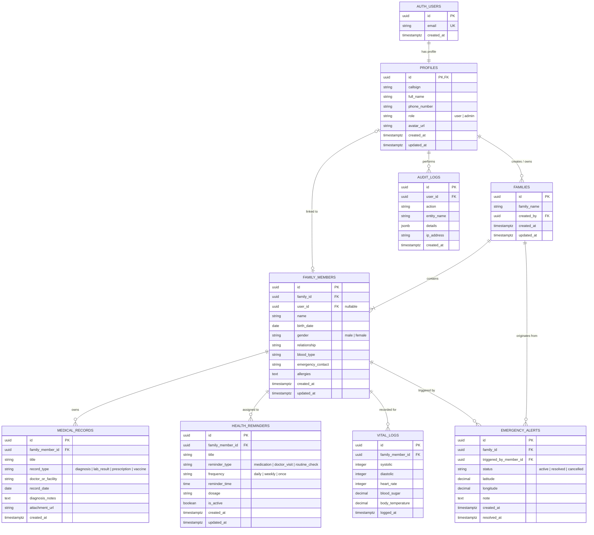

# Spesifikasi Basis Data & Entity Relationship Diagram (ERD) — CareFam

> **Dokumen:** Database Architecture & ERD Specification  
> **Sistem:** CareFam — Family Healthcare Management System  
> **Database Engine:** PostgreSQL 15+ (Supabase Native)  
> **Tingkat Normalisasi:** Third Normal Form (3NF)  
> **Standar Keamanan:** Row Level Security (RLS) & Role-Based Access Control (RBAC)  

---

## 1. Pendahuluan & Logika Bisnis CareFam

CareFam adalah aplikasi mobile pengelolaan kesehatan keluarga yang berorientasi pada kemudahan pemantauan kondisi medis seluruh anggota keluarga dalam satu pintu.

Berdasarkan implementasi Modul 1 hingga Modul 4 dan roadmap fitur layanan, logika bisnis inti sistem meliputi:
1. **Manajemen Identitas & Pengguna (User Identity & Role):**
   - Autentikasi dikelola oleh Supabase Auth (`auth.users`).
   - Setiap pengguna memiliki satu profil (`profiles`) yang memuat data personal, *callsign* (nama panggilan keluarga), dan hak akses (`user` atau `admin`).
2. **Grup Keluarga & Anggota Keluarga (Family & Family Members):**
   - Pengguna dapat membuat atau mengepalai satu grup keluarga (`families`).
   - Di dalam keluarga terdapat daftar anggota keluarga (`family_members`) seperti Ayah, Ibu, Anak, atau Kakek/Nenek, lengkap dengan informasi medis dasar (tanggal lahir, golongan darah, riwayat alergi, dan kontak darurat).
3. **Rekam Medis Digital (Medical Records):**
   - Riwayat diagnosis, resep dokter, hasil laboratorium, dan dokumen kesehatan disimpan per anggota keluarga (`medical_records`).
4. **Pengingat & Monitoring Kesehatan (Health Reminders & Vitals):**
   - Jadwal minum obat atau jadwal kontrol dokter dijadwalkan secara periodik (`health_reminders`).
   - Catatan metrik vital berkala seperti tekanan darah, detak jantung, kadar gula darah, dan suhu tubuh (`vital_logs`).
5. **Bantuan Tanggap Darurat (Emergency SOS Alerts):**
   - Pemicuan sinyal darurat oleh anggota keluarga saat terjadi insiden medis darurat (`emergency_alerts`).
6. **Audit & Log Aktivitas (Admin & Compliance Logs):**
   - Pencatatan aktivitas sensitif pengguna dan sistem untuk kebutuhan audit administrator (`audit_logs`).

---

## 2. Diagram Entity Relationship (ERD)



---

## 3. Kamus Data (Data Dictionary)

### 3.1. Entitas `profiles`
Menyimpan informasi tambahan pengguna aplikasi di luar sistem credential auth.

| Kolom | Tipe Data | Constraint | Keterangan |
|---|---|---|---|
| `id` | `UUID` | **PK**, **FK** `auth.users(id)` | Identitas unik pengguna, relasi 1:1 ke Supabase Auth. |
| `callsign` | `VARCHAR(50)` | Nullable | Nama panggilan keluarga (misal: "Ayah Budi", "Naufal"). |
| `full_name` | `VARCHAR(100)` | Nullable | Nama lengkap pengguna. |
| `phone_number` | `VARCHAR(20)` | Nullable | Nomor telepon aktif untuk verifikasi/kontak darurat. |
| `role` | `VARCHAR(20)` | **NOT NULL**, Default: `'user'` | Hak akses sistem: `'user'` atau `'admin'`. |
| `avatar_url` | `TEXT` | Nullable | Tautan foto profil di Supabase Storage. |
| `created_at` | `TIMESTAMPTZ` | **NOT NULL**, Default: `NOW()` | Waktu profil pertama kali dibuat. |
| `updated_at` | `TIMESTAMPTZ` | **NOT NULL**, Default: `NOW()` | Waktu pembaruan profil terakhir. |

---

### 3.2. Entitas `families`
Mewakili wadah atau unit keluarga tempat berkumpulnya anggota keluarga.

| Kolom | Tipe Data | Constraint | Keterangan |
|---|---|---|---|
| `id` | `UUID` | **PK**, Default: `gen_random_uuid()` | Pengenal unik grup keluarga. |
| `family_name` | `VARCHAR(100)` | **NOT NULL** | Nama grup keluarga (misal: "Keluarga Santoso"). |
| `created_by` | `UUID` | **FK** `profiles(id)`, **NOT NULL** | Pengguna yang mendaftarkan grup keluarga ini. |
| `created_at` | `TIMESTAMPTZ` | **NOT NULL**, Default: `NOW()` | Waktu pembentukan keluarga. |
| `updated_at` | `TIMESTAMPTZ` | **NOT NULL**, Default: `NOW()` | Waktu perubahan informasi keluarga. |

---

### 3.3. Entitas `family_members`
Menyimpan profil personal dan rekam medis individual tiap anggota keluarga.

| Kolom | Tipe Data | Constraint | Keterangan |
|---|---|---|---|
| `id` | `UUID` | **PK**, Default: `gen_random_uuid()` | Pengenal unik anggota keluarga. |
| `family_id` | `UUID` | **FK** `families(id)` **ON DELETE CASCADE** | Referensi ke grup keluarga. |
| `user_id` | `UUID` | **FK** `profiles(id)` **ON DELETE SET NULL**, Nullable | Akun login jika anggota keluarga sudah menginstal aplikasi. |
| `name` | `VARCHAR(100)` | **NOT NULL** | Nama anggota keluarga. |
| `birth_date` | `DATE` | **NOT NULL** | Tanggal lahir (untuk kalkulasi usia dan jadwal imunisasi). |
| `gender` | `VARCHAR(10)` | Check: `'male' \| 'female'` | Jenis kelamin. |
| `relationship` | `VARCHAR(50)` | **NOT NULL** | Status hubungan (Kepala Keluarga, Istri, Anak, Kakek, dll). |
| `blood_type` | `VARCHAR(5)` | Check: `'A' \| 'B' \| 'AB' \| 'O' \| '-'` | Golongan darah untuk penanganan darurat. |
| `emergency_contact`| `VARCHAR(25)` | Nullable | Nomor darurat yang dapat dihubungi. |
| `allergies` | `TEXT` | Nullable | Riwayat alergi obat/makanan (kritis untuk medis). |
| `created_at` | `TIMESTAMPTZ` | **NOT NULL**, Default: `NOW()` | Waktu pencatatan anggota. |
| `updated_at` | `TIMESTAMPTZ` | **NOT NULL**, Default: `NOW()` | Waktu pembaruan data anggota. |

---

### 3.4. Entitas `medical_records`
Menyimpan riwayat pemeriksaan, hasil lab, diagnosis, dan resep dokter.

| Kolom | Tipe Data | Constraint | Keterangan |
|---|---|---|---|
| `id` | `UUID` | **PK**, Default: `gen_random_uuid()` | Pengenal unik rekam medis. |
| `family_member_id` | `UUID` | **FK** `family_members(id)` **ON DELETE CASCADE** | Anggota keluarga yang memiliki rekam medis ini. |
| `title` | `VARCHAR(150)` | **NOT NULL** | Judul tindakan (misal: "Medical Checkup Tahunan"). |
| `record_type` | `VARCHAR(50)` | Check: `diagnosis, lab_result, prescription, vaccine` | Kategori berkas medis. |
| `doctor_or_facility`| `VARCHAR(150)`| Nullable | Nama dokter atau fasilitas kesehatan pemeriksa. |
| `record_date` | `DATE` | **NOT NULL** | Tanggal pemeriksaan medis. |
| `diagnosis_notes` | `TEXT` | Nullable | Catatan ringkasan dokter, hasil observasi, anjuran. |
| `attachment_url` | `TEXT` | Nullable | Tautan berkas bukti (PDF scan / foto hasil lab). |
| `created_at` | `TIMESTAMPTZ` | **NOT NULL**, Default: `NOW()` | Waktu input data ke sistem. |

---

### 3.5. Entitas `health_reminders`
Mengatur jadwal minum obat dan kontrol kesehatan berkala anggota keluarga.

| Kolom | Tipe Data | Constraint | Keterangan |
|---|---|---|---|
| `id` | `UUID` | **PK**, Default: `gen_random_uuid()` | Pengenal unik jadwal pengingat. |
| `family_member_id` | `UUID` | **FK** `family_members(id)` **ON DELETE CASCADE** | Anggota keluarga yang wajib mematuhi pengingat ini. |
| `title` | `VARCHAR(100)` | **NOT NULL** | Nama pengingat (misal: "Minum Amlodipine 5mg"). |
| `reminder_type` | `VARCHAR(50)` | Check: `medication, doctor_visit, routine_check` | Tipe pengingat. |
| `frequency` | `VARCHAR(50)` | Check: `daily, weekly, monthly, once` | Frekuensi pengulangan. |
| `reminder_time` | `TIME` | **NOT NULL** | Waktu alarm pengingat berbunyi. |
| `dosage` | `VARCHAR(50)` | Nullable | Dosis (misal: "1 tablet sesudah makan"). |
| `is_active` | `BOOLEAN` | **NOT NULL**, Default: `TRUE` | Status aktif/tidaknya alarm pengingat. |
| `created_at` | `TIMESTAMPTZ` | **NOT NULL**, Default: `NOW()` | Waktu pembuatan reminder. |
| `updated_at` | `TIMESTAMPTZ` | **NOT NULL**, Default: `NOW()` | Waktu perubahan jadwal. |

---

### 3.6. Entitas `vital_logs`
Menyimpan hasil monitoring parameter vital kesehatan berkala.

| Kolom | Tipe Data | Constraint | Keterangan |
|---|---|---|---|
| `id` | `UUID` | **PK**, Default: `gen_random_uuid()` | Pengenal unik entri metrik vital. |
| `family_member_id` | `UUID` | **FK** `family_members(id)` **ON DELETE CASCADE** | Anggota keluarga bersangkutan. |
| `systolic` | `INT` | Nullable, Range: 50–300 | Tekanan darah sistolik (mmHg). |
| `diastolic` | `INT` | Nullable, Range: 30–200 | Tekanan darah diastolik (mmHg). |
| `heart_rate` | `INT` | Nullable, Range: 30–250 | Denyut nadi per menit (BPM). |
| `blood_sugar` | `DECIMAL(5,2)` | Nullable | Gula darah sewaktu (mg/dL). |
| `body_temperature`| `DECIMAL(4,1)` | Nullable | Suhu tubuh (°C). |
| `logged_at` | `TIMESTAMPTZ` | **NOT NULL**, Default: `NOW()` | Waktu pencatatan vital aktual. |

---

### 3.7. Entitas `emergency_alerts`
Menyimpan rekaman sinyal bahaya dan panggilan darurat (Emergency SOS).

| Kolom | Tipe Data | Constraint | Keterangan |
|---|---|---|---|
| `id` | `UUID` | **PK**, Default: `gen_random_uuid()` | Pengenal unik insiden SOS. |
| `family_id` | `UUID` | **FK** `families(id)` **ON DELETE CASCADE** | Keluarga tujuan siaran darurat. |
| `triggered_by_member_id` | `UUID` | **FK** `family_members(id)` | Anggota keluarga yang memicu sinyal. |
| `status` | `VARCHAR(20)` | Check: `active, resolved, cancelled` | Status penanganan alarm darurat. |
| `latitude` | `DECIMAL(9,6)` | Nullable | Titik koordinat lintang kejadian. |
| `longitude` | `DECIMAL(9,6)` | Nullable | Titik koordinat bujur kejadian. |
| `note` | `TEXT` | Nullable | Catatan darurat tambahan (gejala, keluhan cepat). |
| `created_at` | `TIMESTAMPTZ` | **NOT NULL**, Default: `NOW()` | Waktu sinyal darurat dipicu. |
| `resolved_at` | `TIMESTAMPTZ` | Nullable | Waktu kondisi darurat selesai ditangani. |

---

### 3.8. Entitas `audit_logs`
Mencatat jejak audit keamanan dan operasional untuk kebutuhan monitoring admin.

| Kolom | Tipe Data | Constraint | Keterangan |
|---|---|---|---|
| `id` | `UUID` | **PK**, Default: `gen_random_uuid()` | Pengenal log audit. |
| `user_id` | `UUID` | **FK** `profiles(id)` **ON DELETE SET NULL** | Pengguna yang melakukan aksi. |
| `action` | `VARCHAR(100)` | **NOT NULL** | Jenis aksi (misal: `LOGIN`, `DELETE_MEMBER`, `SOS_TRIGGER`). |
| `entity_name` | `VARCHAR(50)` | **NOT NULL** | Nama tabel sasaran (misal: `family_members`). |
| `details` | `JSONB` | Nullable | Snapshot payload perubahan data. |
| `ip_address` | `VARCHAR(45)` | Nullable | Alamat IP jaringan pengguna. |
| `created_at` | `TIMESTAMPTZ` | **NOT NULL**, Default: `NOW()` | Waktu terjadinya aksi. |

---

## 4. Keamanan & Kebijakan Akses: Row Level Security (RLS)

Karena CareFam mengelola data kesehatan keluarga yang bersifat pribadi dan konfidensial, arsitektur basis data menerapkan **Row Level Security (RLS)** bawaan PostgreSQL/Supabase:

1. **Prinsip Isolasi Data Keluarga:**
   - Pengguna hanya memiliki hak akses `SELECT`, `INSERT`, `UPDATE`, `DELETE` terhadap tabel `family_members`, `medical_records`, dan `vital_logs` jika anggota keluarga tersebut berada di dalam grup `family_id` yang dibuat oleh pengguna tersebut.
2. **Prinsip Hak Akses Administrator:**
   - Profil dengan `role = 'admin'` memiliki kebijakan akses lintas keluarga khusus untuk fungsi audit dan agregasi statistik makro (seperti jumlah keluarga terdaftar dan total record).

---

## 5. Skrip DDL PostgreSQL (Ready-to-Deploy)

Berikut skrip SQL resmi yang dapat langsung dijalankan di **Supabase SQL Editor**:

```sql
-- 1. EXTENSIONS
CREATE EXTENSION IF NOT EXISTS "uuid-ossp";

-- 2. TABEL PROFILES
CREATE TABLE public.profiles (
    id UUID PRIMARY KEY REFERENCES auth.users(id) ON DELETE CASCADE,
    callsign VARCHAR(50),
    full_name VARCHAR(100),
    phone_number VARCHAR(20),
    role VARCHAR(20) NOT NULL DEFAULT 'user' CHECK (role IN ('user', 'admin')),
    avatar_url TEXT,
    created_at TIMESTAMPTZ NOT NULL DEFAULT NOW(),
    updated_at TIMESTAMPTZ NOT NULL DEFAULT NOW()
);

-- Trigger auto create profile on signup
CREATE OR REPLACE FUNCTION public.handle_new_user()
RETURNS TRIGGER AS $$
BEGIN
    INSERT INTO public.profiles (id, callsign, role)
    VALUES (
        NEW.id,
        COALESCE(NEW.raw_user_meta_data->>'callsign', 'Keluarga'),
        COALESCE(NEW.raw_user_meta_data->>'role', 'user')
    );
    RETURN NEW;
END;
$$ LANGUAGE plpgsql SECURITY DEFINER;

CREATE OR REPLACE TRIGGER on_auth_user_created
    AFTER INSERT ON auth.users
    FOR EACH ROW EXECUTE FUNCTION public.handle_new_user();

-- 3. TABEL FAMILIES
CREATE TABLE public.families (
    id UUID PRIMARY KEY DEFAULT gen_random_uuid(),
    family_name VARCHAR(100) NOT NULL,
    created_by UUID NOT NULL REFERENCES public.profiles(id) ON DELETE CASCADE,
    created_at TIMESTAMPTZ NOT NULL DEFAULT NOW(),
    updated_at TIMESTAMPTZ NOT NULL DEFAULT NOW()
);

-- 4. TABEL FAMILY_MEMBERS
CREATE TABLE public.family_members (
    id UUID PRIMARY KEY DEFAULT gen_random_uuid(),
    family_id UUID NOT NULL REFERENCES public.families(id) ON DELETE CASCADE,
    user_id UUID REFERENCES public.profiles(id) ON DELETE SET NULL,
    name VARCHAR(100) NOT NULL,
    birth_date DATE NOT NULL,
    gender VARCHAR(10) CHECK (gender IN ('male', 'female')),
    relationship VARCHAR(50) NOT NULL,
    blood_type VARCHAR(5) CHECK (blood_type IN ('A', 'B', 'AB', 'O', '-')),
    emergency_contact VARCHAR(25),
    allergies TEXT,
    created_at TIMESTAMPTZ NOT NULL DEFAULT NOW(),
    updated_at TIMESTAMPTZ NOT NULL DEFAULT NOW()
);

-- 5. TABEL MEDICAL_RECORDS
CREATE TABLE public.medical_records (
    id UUID PRIMARY KEY DEFAULT gen_random_uuid(),
    family_member_id UUID NOT NULL REFERENCES public.family_members(id) ON DELETE CASCADE,
    title VARCHAR(150) NOT NULL,
    record_type VARCHAR(50) NOT NULL CHECK (record_type IN ('diagnosis', 'lab_result', 'prescription', 'vaccine')),
    doctor_or_facility VARCHAR(150),
    record_date DATE NOT NULL,
    diagnosis_notes TEXT,
    attachment_url TEXT,
    created_at TIMESTAMPTZ NOT NULL DEFAULT NOW()
);

-- 6. TABEL HEALTH_REMINDERS
CREATE TABLE public.health_reminders (
    id UUID PRIMARY KEY DEFAULT gen_random_uuid(),
    family_member_id UUID NOT NULL REFERENCES public.family_members(id) ON DELETE CASCADE,
    title VARCHAR(100) NOT NULL,
    reminder_type VARCHAR(50) NOT NULL CHECK (reminder_type IN ('medication', 'doctor_visit', 'routine_check')),
    frequency VARCHAR(50) NOT NULL DEFAULT 'daily' CHECK (frequency IN ('daily', 'weekly', 'monthly', 'once')),
    reminder_time TIME NOT NULL,
    dosage VARCHAR(50),
    is_active BOOLEAN NOT NULL DEFAULT TRUE,
    created_at TIMESTAMPTZ NOT NULL DEFAULT NOW(),
    updated_at TIMESTAMPTZ NOT NULL DEFAULT NOW()
);

-- 7. TABEL VITAL_LOGS
CREATE TABLE public.vital_logs (
    id UUID PRIMARY KEY DEFAULT gen_random_uuid(),
    family_member_id UUID NOT NULL REFERENCES public.family_members(id) ON DELETE CASCADE,
    systolic INT CHECK (systolic BETWEEN 40 AND 300),
    diastolic INT CHECK (diastolic BETWEEN 30 AND 200),
    heart_rate INT CHECK (heart_rate BETWEEN 30 AND 250),
    blood_sugar DECIMAL(5,2),
    body_temperature DECIMAL(4,1),
    logged_at TIMESTAMPTZ NOT NULL DEFAULT NOW()
);

-- 8. TABEL EMERGENCY_ALERTS
CREATE TABLE public.emergency_alerts (
    id UUID PRIMARY KEY DEFAULT gen_random_uuid(),
    family_id UUID NOT NULL REFERENCES public.families(id) ON DELETE CASCADE,
    triggered_by_member_id UUID REFERENCES public.family_members(id) ON DELETE SET NULL,
    status VARCHAR(20) NOT NULL DEFAULT 'active' CHECK (status IN ('active', 'resolved', 'cancelled')),
    latitude DECIMAL(9,6),
    longitude DECIMAL(9,6),
    note TEXT,
    created_at TIMESTAMPTZ NOT NULL DEFAULT NOW(),
    resolved_at TIMESTAMPTZ
);

-- 9. TABEL AUDIT_LOGS
CREATE TABLE public.audit_logs (
    id UUID PRIMARY KEY DEFAULT gen_random_uuid(),
    user_id UUID REFERENCES public.profiles(id) ON DELETE SET NULL,
    action VARCHAR(100) NOT NULL,
    entity_name VARCHAR(50) NOT NULL,
    details JSONB,
    ip_address VARCHAR(45),
    created_at TIMESTAMPTZ NOT NULL DEFAULT NOW()
);

-- 10. INDEXING OPTIMIZATION
CREATE INDEX idx_families_created_by ON public.families(created_by);
CREATE INDEX idx_family_members_family ON public.family_members(family_id);
CREATE INDEX idx_medical_records_member ON public.medical_records(family_member_id);
CREATE INDEX idx_health_reminders_member ON public.health_reminders(family_member_id);
CREATE INDEX idx_vital_logs_member_date ON public.vital_logs(family_member_id, logged_at DESC);
CREATE INDEX idx_emergency_alerts_family ON public.emergency_alerts(family_id, created_at DESC);
```
